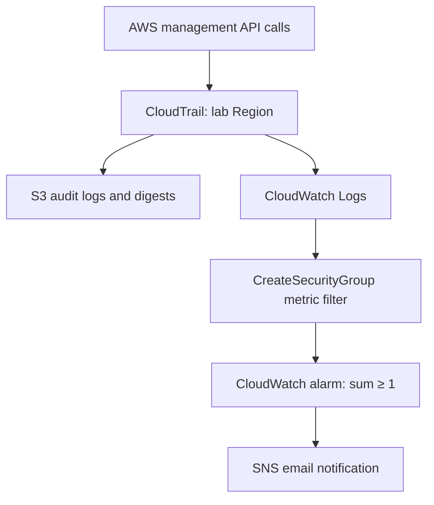

# AWS AuditGuard

An AWS security logging lab built with CloudFormation: record management API activity, inspect audit logs, and receive an email when someone successfully creates an EC2 security group.

**Status:** Infrastructure and scripts prepared; live AWS deployment and end-to-end alert verification are pending. The example event is synthetic, not evidence of a completed deployment.

## Architecture



The trail captures read and write management events across services in one Region. The metric filter selects successful EC2 `CreateSecurityGroup` events. This is a lab scope, not full account-wide security coverage: other Regions, global service events, data events, Insights, and CloudTrail Lake are excluded.

## What this demonstrates

- Infrastructure as code and scoped service permissions.
- CloudTrail identity, timestamp, source IP, action, and response analysis.
- CloudWatch JSON metric filters and alarm state transitions.
- SNS email subscriptions and an end-to-end detection test.
- Cost-aware retention and deliberate teardown.

## Prerequisites

- AWS CLI v2, Bash, and an authenticated temporary AWS session in a lab account.
- Permissions to manage CloudFormation, S3, CloudTrail, CloudWatch Logs/alarms, SNS, and the IAM role in this template, including `iam:PassRole` for that role.
- An existing VPC in the chosen Region, for the test only. No EC2 instance is needed.
- An email address for SNS; confirm the subscription manually.
- Check for existing trails before deploying: overlapping management-event copies can incur charges. Use a quiet lab account.

Do not commit credentials, `.env` files, account-specific raw logs, or unredacted screenshots.

## Deploy

```bash
git clone https://github.com/Varshx183/aws-auditguard.git
cd aws-auditguard
export AWS_REGION=us-east-1
export STACK_NAME=aws-auditguard
# Authenticate through your temporary role/profile or IAM Identity Center first.
aws sts get-caller-identity
bash scripts/deploy.sh
```

The deploy script prompts for an email and prints the stack outputs. It creates chargeable AWS resources. Verify the account shown by STS before deployment. Confirm the email from SNS before generating a test event.

The bucket blocks public access, encrypts objects with SSE-S3, requires TLS, and permits CloudTrail writes only from this trail. CloudTrail log file validation is enabled. Logs expire after seven days in S3; CloudWatch retention defaults to seven days. This short retention is intended for a lab, not compliance archiving.

## Test the detection

Choose an existing VPC in the same Region:

```bash
aws ec2 describe-vpcs --region "$AWS_REGION" --query 'Vpcs[].{ID:VpcId,Default:IsDefault}' --output table
export VPC_ID=vpc-REPLACE_WITH_YOUR_VPC
bash scripts/test-alert.sh
```

The script creates an unattached security group with no inbound rules and deletes it immediately on exit. Deletion does not remove the CloudTrail creation record. If the process is forcibly terminated, inspect and remove any leftover `auditguard-test-*` group manually.

Allow several minutes for CloudTrail delivery and alarm evaluation; timing is not guaranteed. Verify the event in the output log group, the metric, the alarm history, and the email. SNS notifications occur on transitions into ALARM, so a repeat test while already ALARM may not send another email. Wait for OK before repeating.

Filter pattern:

```text
{ ($.eventSource = "ec2.amazonaws.com") && ($.eventName = "CreateSecurityGroup") && ($.errorCode NOT EXISTS) }
```

The alarm uses a one-minute `Sum`, threshold `>= 1`, and missing data treated as not breaching. Filters process newly ingested logs; they do not backfill older events.

## Inspect a raw audit log

From the `BucketName` output, browse `AWSLogs/<account-id>/CloudTrail/<region>/<year>/<month>/<day>/` in S3. Download one `.json.gz` file locally and inspect:

```bash
gzip -dc downloaded-log.json.gz | python -m json.tool
```

S3 files contain a `Records` array. CloudWatch receives individual JSON events. Compare `userIdentity`, `eventTime`, `eventSource`, `eventName`, `sourceIPAddress`, and `responseElements`. Never upload the original account logs publicly; [the example](examples/create-security-group.json) uses fictitious values.

## Cost and cleanup

This lab is low-volume, but **not guaranteed free**. The first management-event copy delivered to S3 has no CloudTrail event charge; S3 storage/requests, CloudTrail delivery to CloudWatch, CloudWatch ingestion/storage/custom metrics/alarms, and SNS can incur charges. Credits and free-tier coverage depend on your account. No EC2 instance, data events, Insights, or Lake is created. Check current pricing and your Billing dashboard.

```bash
bash scripts/cleanup.sh
```

The script removes the stack after confirmation and **retains the S3 audit bucket** to protect evidence. That bucket continues to incur storage charges until expiration or deletion. Follow [cleanup instructions](docs/cleanup.md) to remove it permanently. Custom metric data ages out after publication stops; there is no custom-metric delete API.

## Local validation

```bash
python -m pip install -r requirements-dev.txt
cfn-lint infrastructure/auditguard.yaml
bash -n scripts/*.sh
python -m json.tool examples/create-security-group.json > /dev/null
```

GitHub Actions runs these checks without AWS credentials. Static validation does not prove live delivery or email receipt. Follow [the evidence checklist](docs/evidence.md) after deployment.

## AWS references

- [CloudTrail S3 bucket policy](https://docs.aws.amazon.com/awscloudtrail/latest/userguide/create-s3-bucket-policy-for-cloudtrail.html)
- [CloudTrail monitoring with CloudWatch Logs](https://docs.aws.amazon.com/awscloudtrail/latest/userguide/monitor-cloudtrail-log-files-with-cloudwatch-logs.html)
- [CloudTrail pricing](https://aws.amazon.com/cloudtrail/pricing/)
- [CloudWatch pricing](https://aws.amazon.com/cloudwatch/pricing/)
- [SNS pricing](https://aws.amazon.com/sns/pricing/)
