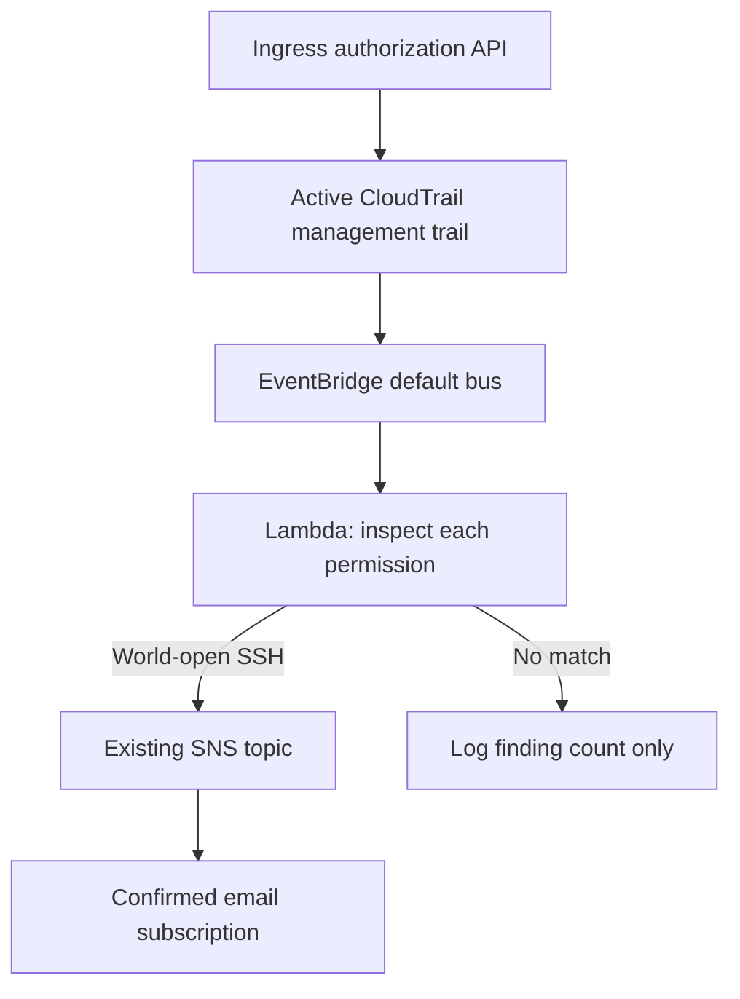

# AG-SSH-001: World-open SSH rule detection

**Status:** AG-SSH-001 ingress authorization was live-verified on October 11, 2026. New modification detection and reliability additions are locally tested; their live validation is pending. The original CreateSecurityGroup alert was live-tested separately; its 147-second measurement does not apply to this detector.

## Threat scenario and scope

A successful `AuthorizeSecurityGroupIngress` call adds a rule permitting TCP port 22 from the entire IPv4 or IPv6 internet. This can create an unnecessary remote-administration exposure when the group is attached to reachable workloads. A rule change alone does not prove host reachability, exploitation, or malicious intent.

EventBridge selects successful ingress authorization events. Python evaluates ports, protocol, and CIDRs within each individual permission. Reusing a simple nested-array log filter could combine a private SSH permission with a separate public HTTPS permission and produce a false match. That exact negative case is covered by a regression test.

## Detection contract

| Input | Expected result |
|---|---|
| TCP/6 port 22, IPv4 `0.0.0.0/0` | Finding |
| TCP port range containing 22, world CIDR | Finding |
| All protocols (`-1`), world CIDR | Finding |
| TCP 22, IPv6 `::/0` | Finding |
| Private or narrower CIDR with SSH | No finding under this rule |
| Public HTTPS or UDP port 22 | No finding |
| Private SSH + public HTTPS in separate permissions | No finding |
| Failed API call or unrelated operation | No finding |

The detector accepts CloudTrail `items` containers and EventBridge envelopes, supports the legacy single-permission request form, and tolerates missing fields. CIDRs are parsed with Python's standard `ipaddress` library rather than matched by substring. An alert includes the event ID, time, group, actor ARN, matching CIDR, and protocol/ports. It omits access-key identifiers and source IP addresses.

## Design decisions

- The original proven CloudTrail/CloudWatch pipeline stays in the base stack. A separate optional stack contains this enhancement.
- Add-on resources include Lambda, a scoped role (or bootstrap-owned role), log group, EventBridge rule, invocation permission, two failure queues, and six health alarms.
- The role can write to its log group and publish to the supplied SNS topic. It can read security-group rule state but has no EC2 modification permissions.
- No automatic remediation: an analyst first assesses workload context and approved exceptions.
- Tested Python source is embedded into the generated CloudFormation JSON. A test prevents source/template drift.
- Seven-day function log retention; no always-running instance or new duplicate trail.
- The runtime-provided Boto3 SDK is used for this small inline Lambda. SNS failures propagate for retries instead of being reported as successful delivery.

## Known gaps and operational limitations

- `AuthorizeSecurityGroupIngress` uses event permissions. `ModifySecurityGroupRules` (AG-SSH-002) inspects referenced rules via a read-only lookup, excluding egress and unrelated groups/IDs. This is current-state evidence, not a historical snapshot: a rule removed before lookup cannot be assessed. Existing rules with no observed changes, prefix lists, referenced groups, and combinations of narrower networks are not assessed.
- A specific public `/32` is not world-open and is outside this rule, though it can still be risky.
- No asset enrichment, routing analysis, or deduplication store. Separate delivery/processing queues and health alarms are defined; retries may send duplicate emails. See `docs/reliability.md`.
- CloudTrail-backed EventBridge delivery is best effort. Events are not a substitute for periodic configuration assessment.
- The add-on expects the default event bus, an active trail, and an SNS topic in the same account and Region. Deleting the base stack first breaks notifications.
- Offline fixtures are synthetic. AG-SSH-001 live delivery is confirmed; OIDC permissions, AG-SSH-002, and failure recovery still require live validation.

## Sources

- [CloudTrail-backed EventBridge events](https://docs.aws.amazon.com/eventbridge/latest/userguide/eb-service-event-cloudtrail.html)
- [CloudTrail integrations and active-trail requirement](https://docs.aws.amazon.com/awscloudtrail/latest/userguide/cloudtrail-aws-service-specific-topics.html)
- [EC2 AuthorizeSecurityGroupIngress API](https://docs.aws.amazon.com/AWSEC2/latest/APIReference/API_AuthorizeSecurityGroupIngress.html)
- [AWS guidance for monitoring security-group changes](https://aws.amazon.com/blogs/security/how-to-monitor-aws-account-configuration-changes-and-api-calls-to-amazon-ec2-security-groups/)

## Modification request handling

AG-SSH-002 accepts the AWS sample's `ModifySecurityGroupRulesRequest` wrapper and uppercase rule identifiers, plus lower-case list/container forms. It resolves referenced rule IDs with `DescribeSecurityGroupRules`, checks group identity and `IsEgress=false`, then evaluates the current ports and CIDR. Unknown request shapes raise an error so retries and the processing-failure destination can preserve them for investigation. Deleted rules produce an unresolved count, not an invented finding. The live test deliberately pauses before deleting the unattached group.

Reference: [AWS sample query for the modification wrapper](https://github.com/aws-samples/cloud-trail-lake-query-samples/blob/main/ec2-public-security-group.sql).
