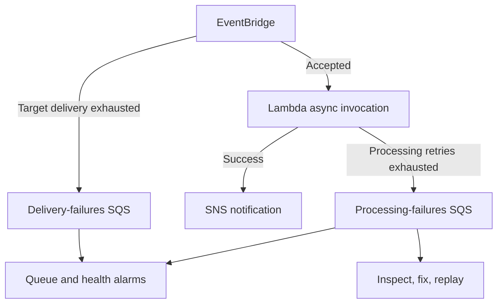

# Failure handling and recovery

Two queues distinguish transport failures from application failures. The EventBridge target DLQ receives events that could not be delivered to Lambda; Lambda's on-failure destination stores invocation records after accepted asynchronous executions exhaust their retry/age policy. Merely raising a Lambda exception does not test the EventBridge delivery DLQ.

Queues use SQS-managed encryption and 14-day message retention. EventBridge delivery retries are bounded at two attempts/one-hour event age; Lambda processing uses two retries/one-hour age. Retrying and replaying can produce duplicates; the event ID supports analyst correlation, but there is no deduplication store. Deleting the detection stack deletes the queues and their contents, so preserve reviewed evidence first.

## Health signals

- Lambda Errors and Throttles.
- Lambda DestinationDeliveryFailures if records cannot reach the failure destination.
- Visible messages in each failure queue.
- EventBridge InvocationsFailedToBeSentToDLQ.

All six alarms use the existing SNS topic. This reduces setup but shares a notification failure domain; monitor the console/metrics directly when SNS is unavailable. SQS metric counts are approximate and may take time to update. This is not proof of lossless delivery or a full production monitoring system.

## Controlled exercise

See `docs/oidc-deployment.md` for invoke → retry → retain → inspect → replay steps. Failure injection is disabled by default and requires both a deployment parameter and a top-level synthetic marker. It raises before SNS publish to exercise processing retry/destination handling. It does not revoke SNS permissions, disrupt real AWS services, or modify security groups.

The replay helper never deletes a message on failed replay, skips unmarked account events, and deletes only the chosen synthetic record after Lambda successfully returns a finding. These behaviors have automated tests. Generic operational replay, automatic remediation, and a transport-DLQ failure injection are future work, not completed validation.
